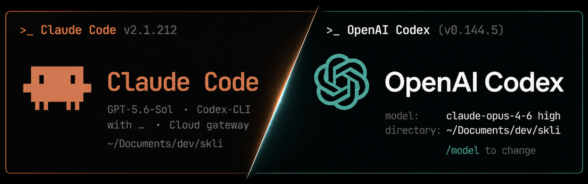

<p align="center">
  
</p>

# macaz

[](https://github.com/macaz-dev/macaz-cli/actions/workflows/ci.yml)

**Use your favorite models and providers with your favorite coding agents.**

macaz connects locally installed coding agents with a model provider chosen by
the user. It starts Claude Code or Codex CLI and routes model interactions while
the selected agent continues to own its local tools, permissions, sessions,
skills, and user interface.

macaz is free and open-source software licensed under Apache-2.0. Every build
contains the complete feature set.

> [!IMPORTANT]
> macaz is an independent interoperability project. It is not affiliated with,
> authorized by, endorsed by, or sponsored by Anthropic, OpenAI, or any other
> client or model provider. Claude Code and Codex CLI are separate products that
> must be obtained from their authorized sources. Each product and provider
> remains subject to its own current terms.

Read [LEGAL.md](LEGAL.md) and [PRIVACY.md](PRIVACY.md) before use.

## What it does

```text
macaz claude   # Claude Code through the selected provider
macaz codex    # Codex CLI through the selected provider
```

The two clients have independent provider/model configuration and isolated
macaz profiles. For example, `macaz claude` can use an OpenAI model while
`macaz codex` uses the official Anthropic API. `macaz reset codex` changes
neither the Claude configuration nor shared provider credentials.

The local routing layer translates both directions:

- Anthropic Messages requests and streams used by Claude Code;
- OpenAI Responses requests and streams used by Codex CLI;
- text, images, supported document inputs, reasoning effort, usage, errors,
  function tools, Codex custom/free-form tools, and tool namespaces; and
- live provider model catalogs into each client's native `/model` interface.

Client-executed tools stay in the client. Shell commands, file edits,
`apply_patch`, skills, hooks, MCP tools, namespaced tools, and subagents are not
executed by macaz or by an upstream CLI adapter. Normal client permission and
sandbox behavior is preserved unless the user explicitly passes that client's
own bypass option.

Server-executed tools are different: a tool such as provider-hosted web
search is available only when the selected provider exposes a compatible
server implementation. macaz disables Codex's OpenAI-hosted web-search request
for provider-neutral sessions rather than silently pretending another provider
can execute it. Local function, custom, namespace, and MCP tools remain
available.

No translation can make different proprietary models semantically identical.
The compatibility target is correct protocol and local-tool behavior without a
hidden provider fallback.

## Install

On macOS or Linux:

```sh
curl -fsSL https://raw.githubusercontent.com/macaz-dev/macaz-cli/main/scripts/install.sh | sh
```

The installer selects the platform release, requires its entry in
`SHA256SUMS`, verifies SHA-256, and installs to `$HOME/.local/bin` by default.
Pin a release with `--version`:

```sh
curl -fsSL https://raw.githubusercontent.com/macaz-dev/macaz-cli/main/scripts/install.sh |
  sh -s -- --version 0.2.0
```

Windows binaries and other release files are published on
[GitHub Releases](https://github.com/macaz-dev/macaz-cli/releases).

Install the latest release in place later with:

```text
macaz update
```

The updater downloads only the exact asset for the current platform, verifies
the release checksums and embedded version, and replaces the executable with
rollback protection. It does not send prompts, source code, configuration, or
provider credentials.

Release builds perform a short best-effort update check on startup. The check
never installs automatically and does not block offline use. Disable it with:

```sh
export MACAZ_NO_UPDATE_CHECK=1
```

## Requirements

- Go is needed only when building from source.
- `claude` must be on `PATH` to use `macaz claude`.
- `codex` must be on `PATH` to use `macaz codex`.
- `opencode` is required only when OpenCode CLI is the selected provider. Local
  agent auth reads existing Codex, OpenCode, or Pi credentials directly and
  does not start those CLIs.
- A browser is used by the OpenAI Subscription authorization flow.

Claude Code, Codex CLI, and OpenCode are not bundled or redistributed.
Compatibility was checked with Claude Code 2.1.328 and Codex CLI 0.170.0.

## Setup and providers

The first invocation of each client opens its own setup:

```text
macaz claude
macaz codex
```

Available upstreams:

| Provider | Claude client | Codex client |
| --- | --- | --- |
| OpenAI Subscription | yes | no (use Codex directly) |
| OpenAI API | yes | no (use Codex directly) |
| OpenRouter API | yes | yes |
| Anthropic API | no (use Claude directly) | yes |
| Codex CLI provider bridge (experimental) | yes | no (recursive) |
| OpenCode CLI provider bridge (experimental) | yes | yes |
| Local agent auth direct adapter (Codex/OpenCode/Pi, experimental) | yes | yes |
| Manual OpenAI-compatible endpoint | yes | yes |

API keys and OAuth credentials configured by macaz are stored in the
operating-system credential store, not in `config.json`. Local agent auth
instead uses a selected credential from Codex's, OpenCode's, or Pi's
`auth.json`. Supported discoveries are appended directly to the provider menu
and identify both the source agent and whether the credential is an API key or
a subscription. The initial direct adapter supports OpenAI OAuth and API-key
entries. OAuth refreshes are written back to that same file under the source's
compatible lock where one exists, with stale-token conflict detection so the
source agent and macaz keep one credential source. The Anthropic option uses an Anthropic API key and
the public Messages API; it does not use or convert a Claude consumer
subscription. Anthropic model IDs, token limits, input capabilities, and effort
levels are read from the account's live Models API during setup and startup.

`Manual provider` accepts either an OpenAI-compatible base URL (including its
port) plus a model ID, or an explicit path to a nonstandard Codex, OpenCode, or
Pi `auth.json`. A base URL without a path is normalized to `/v1`. Manual local
endpoints do not require or send an API key.

Each start refreshes the active provider catalog. The resulting public model
IDs and supported reasoning levels are written to the isolated client profile,
so model selection works through Claude Code's or Codex CLI's native `/model`
interface. The configured provider default is selected at launch; interactive
changes follow the selected client's normal session behavior.

New OpenAI API and OpenRouter profiles start with GPT-6.2 Sol. The live
catalog can include GPT-6.2 Astra and, with Anthropic API or OpenRouter, Claude
Opus 5.5, Sonnet 5.5, Haiku 5.5, and Fable 5.2, depending on account access.
Existing configurations retain their saved model IDs.

## Commands

```text
macaz claude [args...]    Start Claude Code
macaz codex [args...]     Start Codex CLI
macaz status [client]     Check the configured provider and model catalog
macaz doctor [client]     Show the client version and check the provider
macaz reset [client]      Reset one client, or all macaz state when omitted
macaz legal               Show the compatibility notice
macaz update              Install the latest verified release
macaz version             Show the installed version
```

Arguments after `macaz claude` or `macaz codex` are forwarded to that client,
except model/provider/profile overrides that would bypass macaz's authenticated
local routing layer.

Examples:

```sh
macaz claude --dangerously-skip-permissions
macaz codex --sandbox workspace-write
macaz status codex
macaz doctor claude
macaz reset codex
```

`macaz reset claude` or `macaz reset codex` removes only that client's macaz
configuration and isolated profile. It preserves the other client and shared
provider credentials. `macaz reset` with no client removes both macaz profiles,
all macaz-managed credentials, configuration, and isolated session history. It
does not remove normal vendor-client profiles or credentials managed directly
by vendor CLIs.

### Claude MCP servers

On each `macaz claude` start, macaz imports user- and local-scoped MCP server
definitions from the normal Claude Code state into the isolated macaz Claude
profile. This lets the same locally configured MCP servers load in normal
Claude Code and through macaz without copying the rest of Claude's identity,
session, trust, or onboarding state. Project-scoped `.mcp.json` files remain
project files and are discovered normally by both profiles; Claude Code may ask
for approval once per profile.

> [!NOTE]
> Claude.ai account connectors are not local MCP definitions and cannot be
> imported this way. Claude Code fetches those connectors only while its active
> authentication method is a Claude.ai subscription; it does not load them when
> `ANTHROPIC_API_KEY`, `ANTHROPIC_AUTH_TOKEN`, or a third-party provider is
> active. Macaz must set a local authentication token to route model requests,
> so entries such as `claude.ai Google Drive`, `claude.ai Google Calendar`, and
> `claude.ai Gmail` shown by normal `claude mcp list` are unavailable through
> macaz. See the official
> [Claude Code MCP documentation](https://code.claude.com/docs/en/mcp#use-mcp-servers-from-claudeai).

The normal Claude profile is authoritative for an imported server name:

- additions and updates are refreshed into the macaz profile at startup;
- a removal deletes the prior imported copy when that copy was not changed in
  the macaz profile; and
- MCP servers with names that exist only in the macaz profile are preserved.

Change or remove an imported server with the normal `claude mcp` command; the
next macaz start will refresh that change. Use `macaz claude mcp add` or
`remove` for servers intended to exist only in the isolated macaz profile.

Only local MCP definitions are imported. Definitions can themselves contain
command arguments, URLs, headers, or environment variables, so the isolated
copy is written with private file permissions. Claude Code authentication,
Claude.ai connectors, and generic profile state are not copied. A standard
OAuth-backed MCP server may require a separate login for the isolated profile:

```sh
macaz claude mcp login SERVER_NAME
```

Inspect or manage the resulting profile with Claude Code's normal MCP commands:

```sh
macaz claude mcp list
macaz claude mcp get SERVER_NAME
macaz claude mcp add --scope user SERVER_NAME -- COMMAND ARGUMENTS...
macaz claude mcp remove --scope user SERVER_NAME
```

## Isolation and security

- The local routing layer listens on a random `127.0.0.1` port.
- A new random authentication token is generated for every launch.
- The token exists only in the child process environment.
- Config and profile files use private permissions where supported.
- Normal Claude and Codex profiles are not modified. Claude MCP definitions are
  read and copied into the isolated macaz profile as described above.
- The local routing process stops when the launched client exits.
- There is no fallback to a different provider or official model.
- macaz contains no project-operated analytics or telemetry client.

The isolated profiles may contain client-owned session history. See
[PRIVACY.md](PRIVACY.md) for exact data flow and deletion behavior.

## Provider notes

- OpenAI API and OpenRouter use Responses-compatible HTTP adapters. They reject
  truncated streams and invalid tool arguments instead of returning partial
  success. OpenRouter also receives a per-session/per-agent sticky routing key
  without changing the selected model.
- OpenAI Subscription uses device authorization, refreshes credentials, and
  applies bounded account retry/backoff. It is experimental and remains
  subject to OpenAI's current account terms.
- Anthropic API uses native `/v1/models`, `/v1/messages`, and
  `/v1/messages/count_tokens`. Responses custom tools are converted to normal
  Anthropic tools with a typed raw-input wrapper and converted back before
  Codex executes them. JSON schemas are passed in `output_config.format`.
  Models such as Claude Opus 5.5 and Sonnet 5.5 require automatic tool choice.
- The Claude client can use `codex app-server` for authenticated inference
  and native image generation. Macaz derives a private temporary model
  catalog from Codex's local model caches, including the default profile,
  `CODEX_HOME`, sibling profiles, and profiles reported by wrapper executables.
  Malformed cache revisions are skipped when another valid profile is
  available; `MACAZ_CODEX_MODEL_CATALOG` can explicitly select a fully custom
  catalog path. Macaz normalizes supported Codex catalog schema revisions,
  selects direct tool calling, disables Codex execution environments, and
  leaves every source cache unchanged. Claude executes client tools and macaz
  returns each structured result to the same
  app-server thread. Pending turns are isolated by Claude session and agent and
  expire after five minutes. Macaz reserves one CLI slot for new traffic;
  excess pending turns use the safe interrupted-turn fallback instead of
  starving the pool. If the Codex model cache is missing, run Codex once before
  using this experimental bridge.
- For Claude sessions on the Codex CLI bridge, ask for a PNG to use Codex's
  native image generator when the model and account support it. Claude shows a
  link to the generated file. Attach an image to edit it. Claude handles local
  file reads and writes with its own permissions, and macaz forwards image
  attachments and extracts text from supported documents. Image-only PDFs
  require a vision-capable file reader or OCR in the client.
- OpenCode CLI uses an isolated request-scoped provider configuration. Its
  project tools and context are not exposed as a second agent layer.
- Local agent auth bypasses the source agent runtime and uses a selected Codex,
  OpenCode, or Pi credential. The OpenAI adapter follows the same direct API and
  subscription paths as macaz's native OpenAI providers.
- Claude Code controls skill and subagent fan-out. Parallel subagents and Auto
  mode classifier checks can consume substantially more provider usage than a
  single-agent Codex session. Macaz keeps the user's selected model for main,
  background, and subagent work, while OpenAI Subscription fan-out is bounded
  to four concurrent upstream requests by default. Advanced users can change
  `max_concurrent_subscription_requests` in `config.json`.
- Macaz keeps the exact selected model for main, background, classifier, and
  subagent paths. For Claude Code, it uses the launch model's reported context
  limit to size the session and set the automatic compact window. It caps
  reasoning effort for Claude's dedicated conversation-compaction request. The
  default reasoning effort is `medium` and can be changed with `default_effort`
  in `config.json`.

## Local development

Go 1.26.5 or newer is required.

Run from source:

```sh
go run ./cmd/macaz version
go run ./cmd/macaz claude
go run ./cmd/macaz codex
```

Build and run a local binary:

```sh
go build -o ./macaz ./cmd/macaz
./macaz version
./macaz codex
```

Run verification:

```sh
go mod verify
go test ./...
go vet ./...
go test -race ./...
```

Build a complete local release package into ignored `dist/`:

```sh
./scripts/build-release.sh v1.0.0
```

The release script requires an empty output directory and creates static
macOS, Linux, and Windows binaries for amd64 and arm64, plus `SHA256SUMS` for
installer and updater verification. To choose another empty directory:

```sh
OUTPUT_DIR=/tmp/macaz-release ./scripts/build-release.sh v1.0.0
```

Opt-in live-provider tests never run in normal CI:

```sh
MACAZ_OPENAI_API_INTEGRATION_MODEL=<model> go test ./internal/provider/openai -run LiveOpenAIAPI
MACAZ_OPENAI_SUBSCRIPTION_INTEGRATION_MODEL=<model> go test ./internal/provider/openai -run LiveOpenAISubscription
MACAZ_OPENROUTER_INTEGRATION_MODEL=<provider/model> go test ./internal/provider/openrouter -run LiveOpenRouter
MACAZ_CODEX_INTEGRATION_EXECUTABLE=<codex-or-compatible> go test ./internal/provider/codexcli -run LiveCodex
MACAZ_OPENCODE_INTEGRATION_MODEL=<provider/model> go test ./internal/provider/opencodecli -run LiveOpenCode
MACAZ_CLAUDE_INTEGRATION=1 go test ./internal/app -run LiveClaudeLifecycle
```

Every merged pull request on `main` is verified, assigned the next SemVer tag,
built for all supported platforms, and published as a GitHub Release with
checksums, generated release notes, and provenance when the repository is
public. The default bump is patch; the `release:minor` and `release:major`
labels select larger bumps.

## License

Apache License 2.0. See [LICENSE](LICENSE), [NOTICE](NOTICE), and
[THIRD_PARTY_NOTICES.md](THIRD_PARTY_NOTICES.md).
